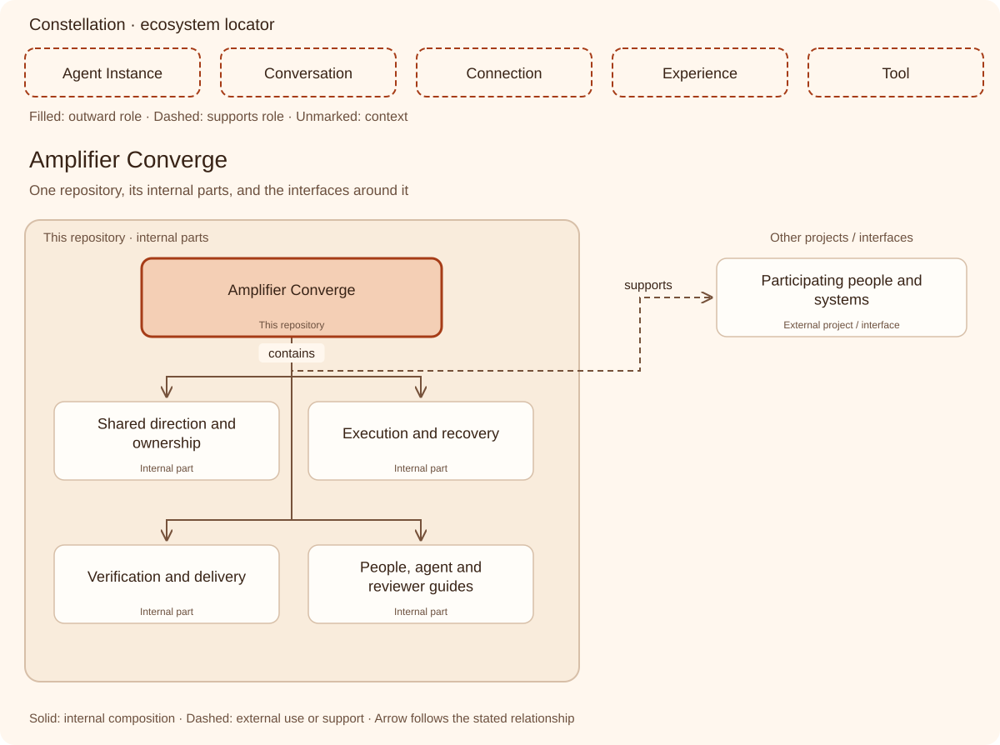

# Amplifier Converge

Converge is a way for people and agents to carry out larger bodies of work together.
It helps a team agree on the outcome, divide responsibilities, and keep the
connections between their work dependable as plans change.

People keep leading their areas. Agents help clarify direction, execute authorized
work, check results, and recover from interruptions. The method works across
agent systems and tools.

## Get started

1. Choose a real outcome and the people responsible for delivering it.
2. Use the [people guide](guides/people-guide.md) to agree on responsibilities and the promises connecting them.
3. Give participating agents the [agent guide](guides/agent-guide.md), then use the [reviewer guide](guides/reviewer-guide.md) to check the combined result.

The [short videos](https://microsoft.github.io/amplifier-converge/) introduce the
method with captions and practical starting prompts. Read the [vision](docs/VISION.md)
for the reasoning behind it.

Applying Converge does not itself authorize new objectives, spending, publication,
or changes to another owner's commitments. Within an agreed assignment, ordinary
decisions do not need another approval at each step.

## The shared promises

The contracts define the method; the guides show how to apply it.

- [Shared direction](contracts/shared-direction-contract.md): agree on the outcome and change it deliberately.
- [Ownership and collaboration](contracts/ownership-and-collaboration-contract.md): assign outcomes and authority, then coordinate where responsibilities meet.
- [Execution and recovery](contracts/execution-and-recovery-contract.md): carry work through without losing or duplicating it.
- [Verification and delivery](contracts/verification-and-delivery-contract.md): demonstrate a usable result.
- [Feedback and learning](contracts/feedback-and-learning-contract.md): turn observations into lasting improvements.
- [System design and decomposition](contracts/system-design-and-decomposition-contract.md): build focused parts with dependable connections.

For authors, see [writing reviewable guidance](docs/writing-guide.md).

<!-- ecosystem-map:start -->
## Where this fits

A collaboration method for people and agents across systems, not a runtime component.

Supports: Agent Instance, Conversation, Connection, Tool, Experience.

[Product website](https://microsoft.github.io/amplifier-converge/) · [Ecosystem map](https://microsoft.github.io/amplifier-constellation/projects/amplifier-converge/) · [Open the map](docs/ecosystem-map.svg) · [Map guide](https://github.com/microsoft/amplifier-constellation/blob/main/docs/ecosystem-maps.md)

The five shared building blocks

<!-- ecosystem-map:end -->

## Contributing

> [!NOTE]
> This project is not currently accepting external contributions, but we're actively working toward opening this up. We value community input and look forward to collaborating in the future. For now, feel free to fork and experiment!

Most contributions require you to agree to a
Contributor License Agreement (CLA) declaring that you have the right to, and actually do, grant us
the rights to use your contribution. For details, visit [Contributor License Agreements](https://cla.opensource.microsoft.com).

When you submit a pull request, a CLA bot will automatically determine whether you need to provide
a CLA and decorate the PR appropriately (e.g., status check, comment). Simply follow the instructions
provided by the bot. You will only need to do this once across all repos using our CLA.

This project has adopted the [Microsoft Open Source Code of Conduct](https://opensource.microsoft.com/codeofconduct/).
For more information see the [Code of Conduct FAQ](https://opensource.microsoft.com/codeofconduct/faq/) or
contact [opencode@microsoft.com](mailto:opencode@microsoft.com) with any additional questions or comments.

## Trademarks

This project may contain trademarks or logos for projects, products, or services. Authorized use of Microsoft
trademarks or logos is subject to and must follow
[Microsoft's Trademark & Brand Guidelines](https://www.microsoft.com/legal/intellectualproperty/trademarks/usage/general).
Use of Microsoft trademarks or logos in modified versions of this project must not cause confusion or imply Microsoft sponsorship.
Any use of third-party trademarks or logos are subject to those third-party's policies.
